# Hearth for Android

Hearth is a self-hosted chat client for your own server. It talks to the [Ollama](https://ollama.com) you run,
searches the web through your own [SearXNG](https://github.com/searxng/searxng), speaks with your own
[Kokoro](https://github.com/remsky/Kokoro-FastAPI) voice and makes pictures with your own
[ComfyUI](https://github.com/comfyanonymous/ComfyUI). There are no accounts and no one else's cloud in the
middle: your conversations stay on the phone, and travel to your other devices only through a hub you run yourself.

<p align="center">
  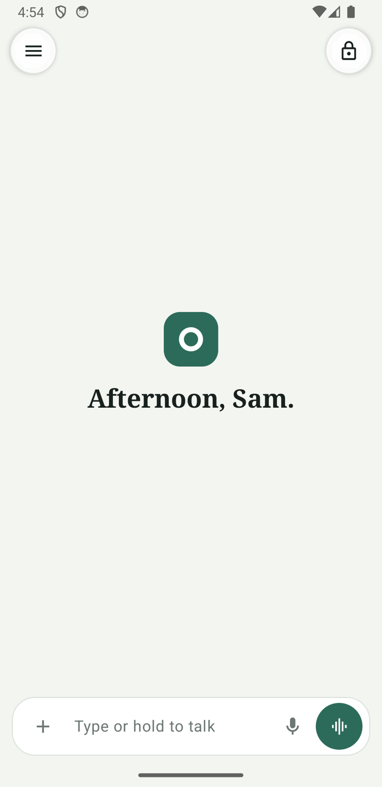
  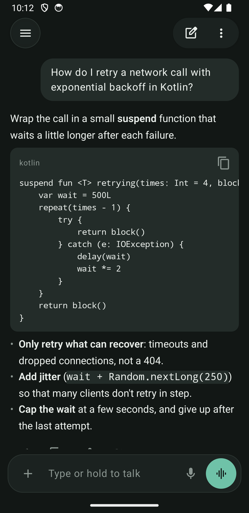
  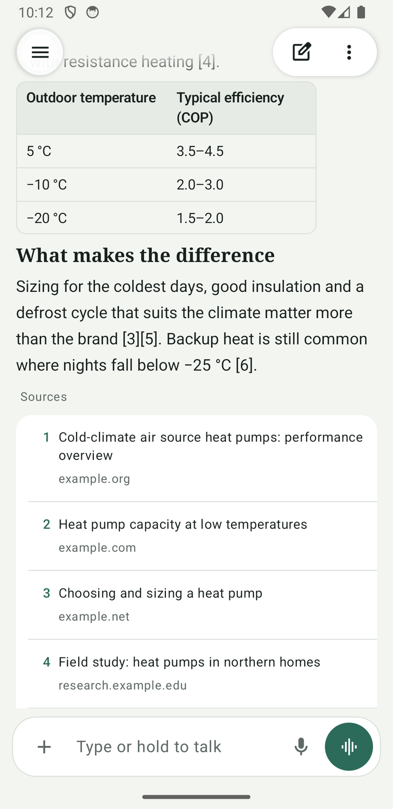
  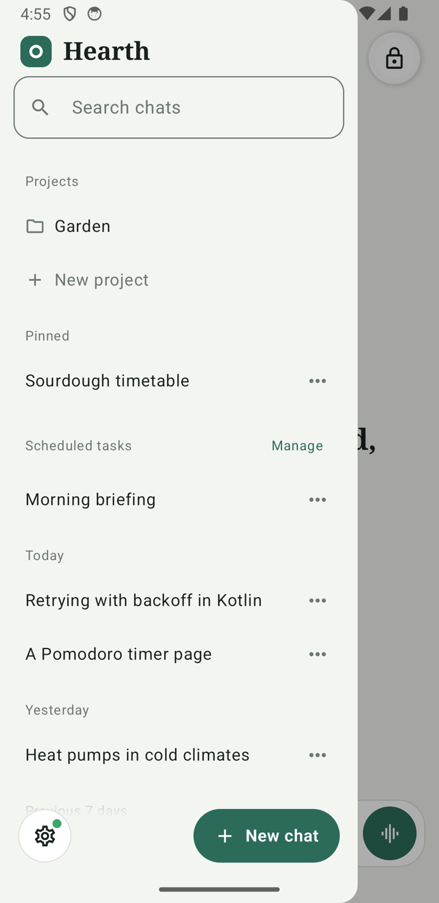
</p>

This is the Android sibling of [Hearth for iPhone, iPad and Mac](https://github.com/cliftonia/Hearth). The two share
a design and a feature list, not code.

- **Platform**: Android 9+, Kotlin, Jetpack Compose
- **Talks to**: Ollama for chat (required); SearXNG for web search, Kokoro-FastAPI for speech, ComfyUI for pictures
  and [Hearth Hub](#sync-with-your-own-hub) for sync and scheduled tasks (all optional)

## What it does

### Chat

- **Any model on your server**, local or passed on to the cloud, chosen from the composer, with how hard it
  thinks: Off, Light, Medium or High
- **Streamed Markdown**: headings, lists, tables, code blocks you can copy, and maths shown as readable text
- **Web search when it is needed**: a model that can call tools searches on its own, reads the top pages and
  cites them; for other models a switch searches before the reply
- **Deep research**: choose it as the effort and ask a question. The chat's own model plans a handful of searches,
  reads about a dozen pages, takes notes and writes a report that cites its numbered sources. The steps show as it
  works, and Stop ends it at once
- **The canvas**: a web page, a drawing, a document or a long block of code in a reply folds into a card that opens
  it on its own, working, with Copy, Share and earlier versions. A page runs its own scripts but cannot reach the
  network
- **Attachments**: photos from the library or camera for models that can see, PDFs and text files for any model
- **Pictures** made on your ComfyUI from a description, or by changing a photo you attach
- **Follow-up questions**, **edit and resend**, and **Try again** with earlier replies kept to step back through
- **Memory**: lasting facts you tell a model are kept on the phone and given to every chat. A **private chat**
  uses none and adds none
- **Projects** gather chats round a subject, with instructions and reference files every chat in it is given
- **Share to Hearth** from other apps: words, links, pictures, PDFs and text files land in the composer

### Voice

- **Dictation** with the microphone button, or by holding the composer down while you talk
- **A voice conversation**: speak, hear the answer in your own voice, speak again
- **Voice with the camera**: one still picture goes with each thing you say, so you can ask about what is in
  front of you. Nothing is recorded
- **Read replies aloud** as they are written, if you like

### Your chats, kept in step

- **History** in a side list: pinned chats, the chats scheduled tasks filed, then the rest by day; searchable, with
  pin, rename, share as Markdown, add to a project and delete
- **Sync with per-person keys**: ordinary chats, projects, memories and scheduled tasks kept in step with your
  other phones, tablets and Macs running Hearth, through your own Hearth Hub. Each person on the hub has an access
  key of their own, kept sealed by the phone's keystore. Off until you turn it on; private chats, settings, server
  addresses and your profile never leave the phone
- **Scheduled tasks**: a question and a time ("Every day at 7:30", "Every Friday at 18:00", "Once, 10 Dec at
  9:00"). Your hub asks it at that time, searching the web first if you like, and files the answer as a new chat
  that reaches every device. The **Automatic** model, the default, leaves the choice to the hub; otherwise you pick a
  cloud model. Start one from Settings or from **Schedule a task** in the composer's + menu
- **Notifications** when a reply or a picture finishes while Hearth is not on screen, and when a scheduled task's
  answer arrives. A private chat's notification says only that a reply is ready
- **Lock** with fingerprint, face or the phone's screen lock; while it is on the app is hidden in the recent apps
  list and kept out of screenshots
- **Themes**: follow the system, or keep to light or dark. A side-by-side layout on wide screens
- **Vibration**: a light tap as a message is sent or a reply finishes, with one switch to silence it
- **Erase all data on this device**, last in Settings: one button removes everything the app holds. It turns sync
  off first, so nothing is deleted on the hub or your other devices
- **Home screen widgets** for a new chat and for a voice conversation

## Screenshots

| | | |
|---|---|---|
| <br>A new chat greets you by name | <br>A reply with code | <br>Deep research with its sources |
| 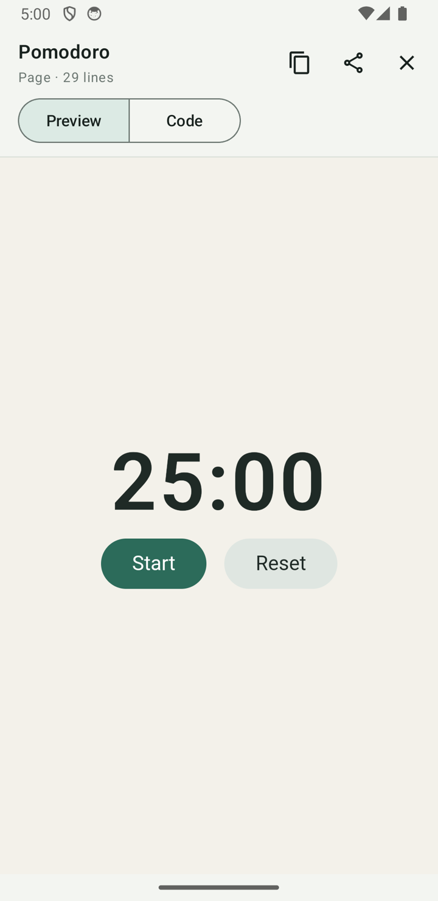<br>A page open in the canvas | 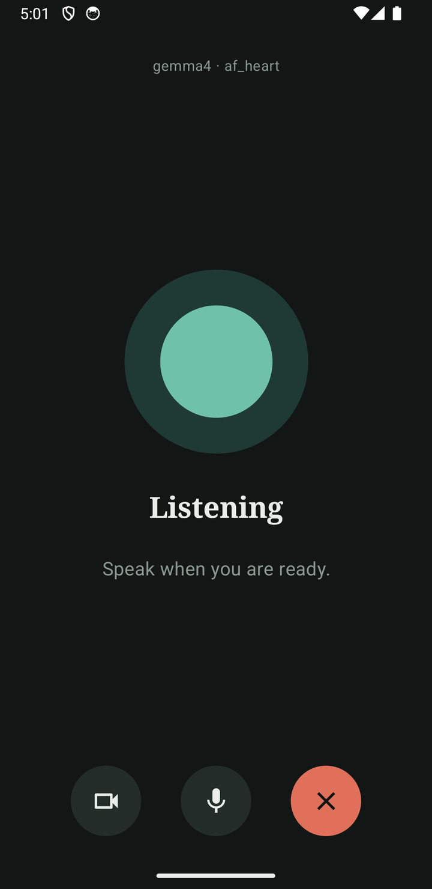<br>A voice conversation | 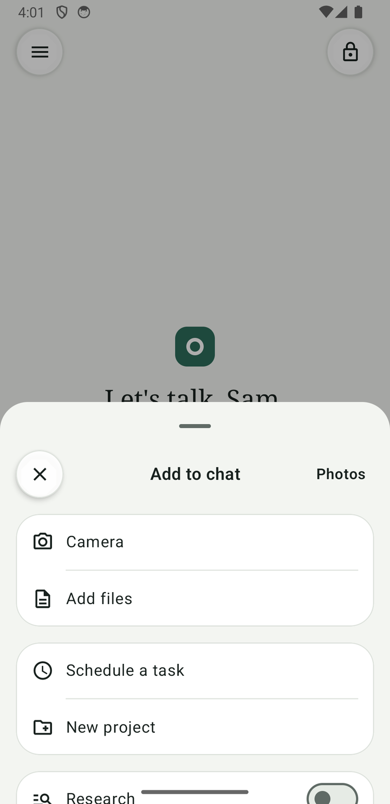<br>The + menu |
| <br>The side list | 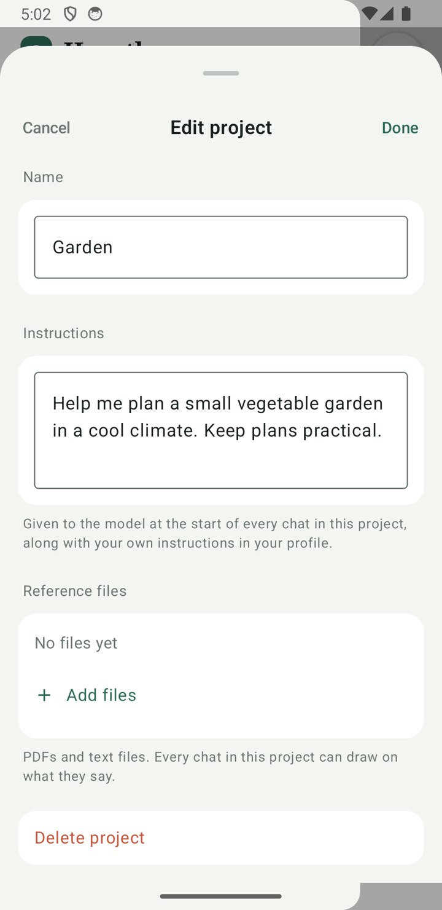<br>A project | 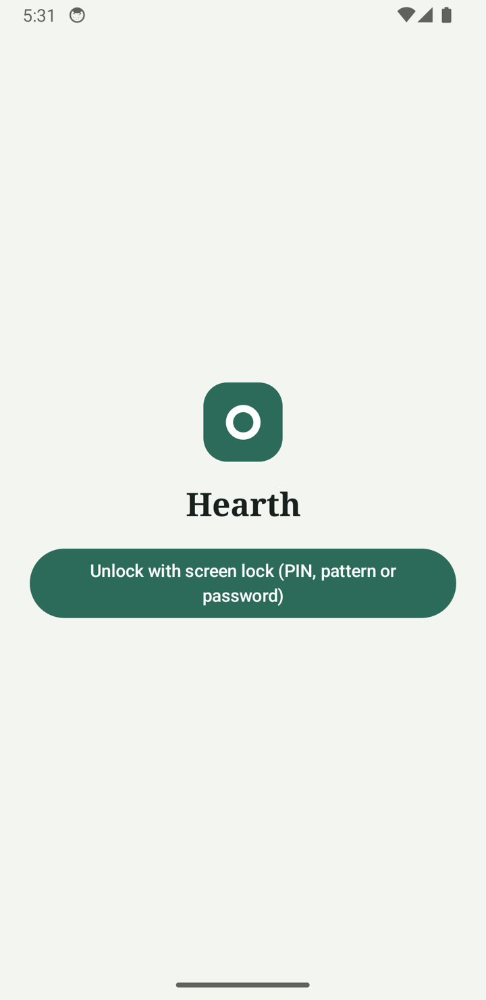<br>The lock |
| 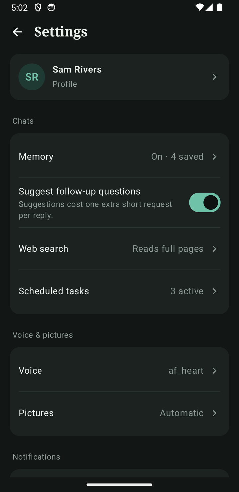<br>Settings | 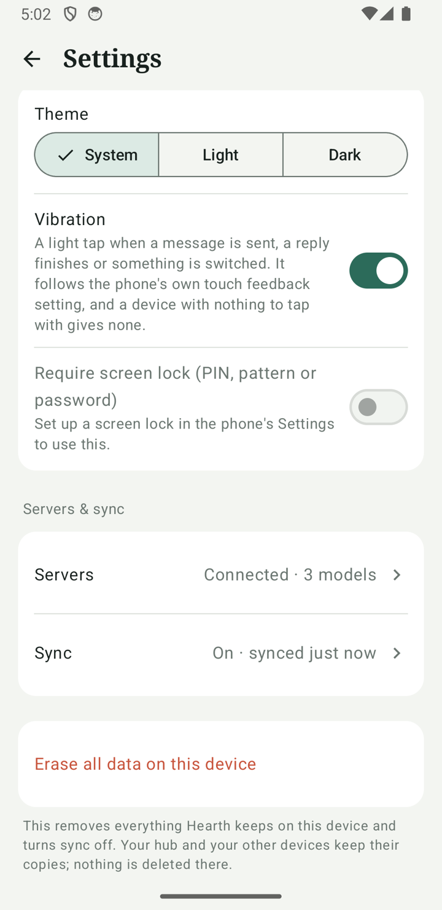<br>More settings | 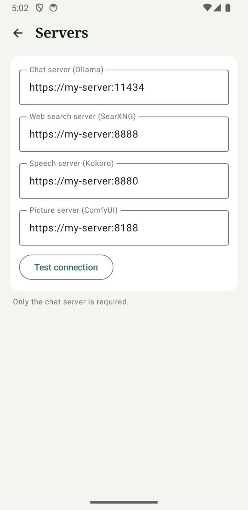<br>Servers |
| 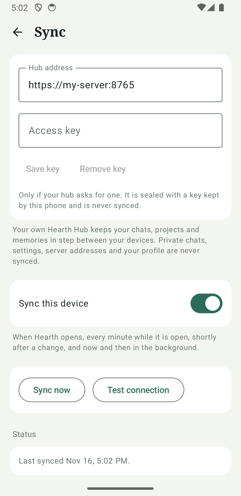<br>Sync | 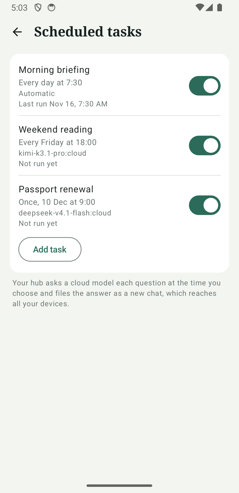<br>Scheduled tasks | 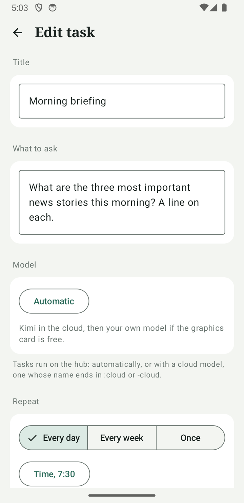<br>A task |
| 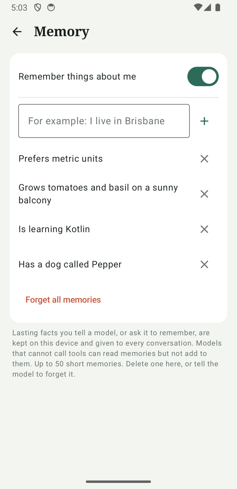<br>Memory | 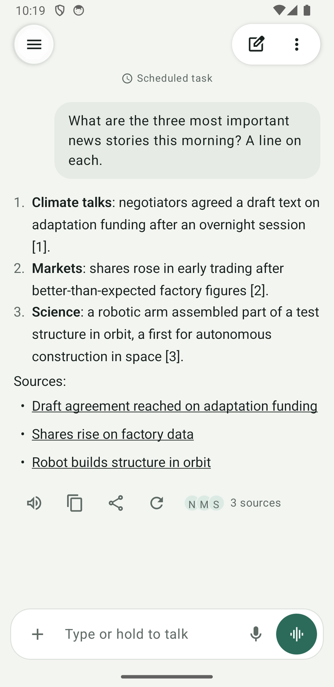<br>A reply with its sources | 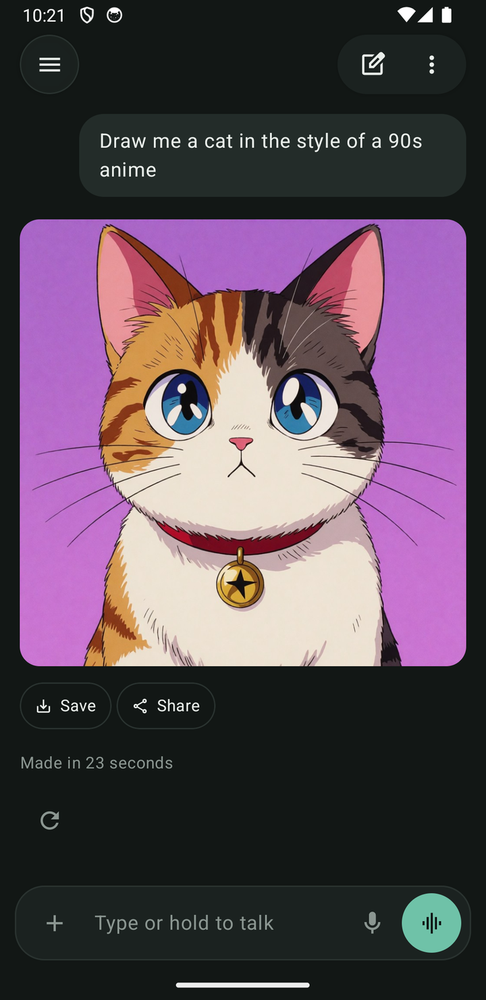<br>A picture made on your server |

The pictures were taken from a debug build's sample data (see [Sample data](#sample-data)), not from real chats.

## Setting up

You need Android Studio (or the Android SDK and JDK 17) and a phone or emulator with Android 9 or later.

```sh
cp local.example.properties local.properties   # then fill it in
./gradlew assembleDebug
```

`local.properties` is ignored by git, so nothing in it reaches the repository. The keys:

| Key | What it is |
|---|---|
| `sdk.dir` | Where the Android SDK is; Android Studio writes it for you |
| `hearth.ollamaAddress` | The chat server the app starts with |
| `hearth.searchAddress` | The SearXNG server, for web search and research (optional) |
| `hearth.speechAddress` | The Kokoro-FastAPI server, for the voice (optional) |
| `hearth.imageAddress` | The ComfyUI server, for pictures (optional) |
| `hearth.hubAddress` | Your Hearth Hub; it only fills in the Sync page, and sync stays off until you turn it on (optional) |
| `hearth.defaultModel` | The model the app starts with, by its name on the server (optional) |
| `hearth.applicationId` | Your own application id, if you sign and publish the app yourself (optional) |

Every address is only where the app starts: all of them can be changed in Settings → Servers, and the app runs
with none built in, asking for them on first launch. SearXNG needs `json` among its `search.formats`.

### Sync with your own hub

Hearth Hub is a small server of your own, kept in a separate repository, that holds a copy of what each device
syncs and runs scheduled tasks. In Settings → Servers & sync → Sync, enter its address and your access key, then turn
on **Sync this device**. Each person has a key of their own, so two people can share a hub without sharing chats.
A copy changed on two devices is settled by the later change, item by item, and a deletion travels as a tombstone.

## Building and testing

```sh
./gradlew test                 # unit tests: domain, data and the app's presenters
./gradlew lintDebug            # Android lint
./gradlew assembleDebug        # a debug build
./gradlew assembleRelease      # a release build (unsigned unless you add your own signing)
```

The domain and data modules are plain Kotlin with no Android in them, so their tests run on the JVM alone. The
same checks run on every push through `.github/workflows/android.yml`, which needs no `local.properties`.

Test vectors shared with the iPhone app and Hearth Hub live in the iPhone repository's `Spec/` folder. Run
`tools/sync-spec.sh` after it changes; `SpecCopyTests` fails while the copy here differs.

### Sample data

A debug build can fill itself with sample data for pictures and demos:

```sh
adb shell am start -n app.hearth.android/app.hearth.MainActivity --ez hearth_screenshots true
```

It adds example chats, a project, memories, scheduled tasks, a canvas page, a research report, a stand-in model
list and placeholder addresses such as `https://my-server:11434`, and stops the app reaching any server for them.
Clear the app's storage (`adb shell pm clear app.hearth.android`) or uninstall it to return to normal; the
in-app Erase leaves the sample data switch in place. Release builds contain none of this.

## Architecture

Three Gradle modules, each seeing only the one below it:

| Module | Holds | Depends on |
|---|---|---|
| `app` | The coordinator, presenters, Compose screens, the design system, the phone's own services | `domain` |
| `domain` | Models, interactors, stores, planners and transformers | `data` |
| `data` | HTTP services and DTOs for Ollama, SearXNG, Kokoro, ComfyUI, Hearth Hub and web pages | nothing |

Each screen has a presenter that owns its state as a `StateFlow` and asks the coordinator for navigation through a
delegate. Dependencies are passed as closures and small provider classes; there is no injection framework.

- [docs/ARCHITECTURE.md](docs/ARCHITECTURE.md): the modules, the presenter and coordinator pattern, where things
  live, and how sync, research, the canvas and voice work
- [docs/DESIGN_SYSTEM.md](docs/DESIGN_SYSTEM.md): the colour, type, spacing and shape tokens and the shared components

## Privacy

- **Your servers, your data.** The app talks only to the addresses you give it, and to public web pages when a
  search or research reads them. There is no analytics and no crash reporting.
- **On the phone.** Chats, projects, memories and settings are files in the app's own storage. Erasing removes
  them all.
- **Sync sends only what it should.** Private chats never reach the hub, not even as a deletion; nor do settings,
  addresses, your profile or the access key. The key goes only in the request's `Authorization` header.
- **Web pages are untrusted.** Only public HTTPS pages are read; names that point at private, local or tailnet
  addresses are refused. Search results and page text reach the model fenced off as material, never as
  instructions, and cannot plant a memory.
- **A page a model wrote is shut in.** The canvas runs it with no origin, no storage and every network load and
  navigation refused. Android's web view leaves two small gaps (`dns-prefetch` and `preconnect`); see
  [docs/ARCHITECTURE.md](docs/ARCHITECTURE.md).
- **The camera takes one still at a time** in a voice conversation, only as you finish speaking, and never records.
- **A private chat stays private** on the lock screen: its notification carries neither its title nor its words.
- **The log** holds counts and kinds of failure, never what you wrote or what a model said.

## Good to know

- Background sync runs when Android's job scheduler allows it, about every fifteen minutes at best and only with a
  network. A reply keeps going, and its notification is posted, only while Android leaves the app running.
- Dictation stops at the first pause, as Android's recogniser takes one utterance at a time.
- A photo sent to a model is at most 1,568 pixels on its longest side.
- Turning the phone round starts a page in the canvas afresh.
