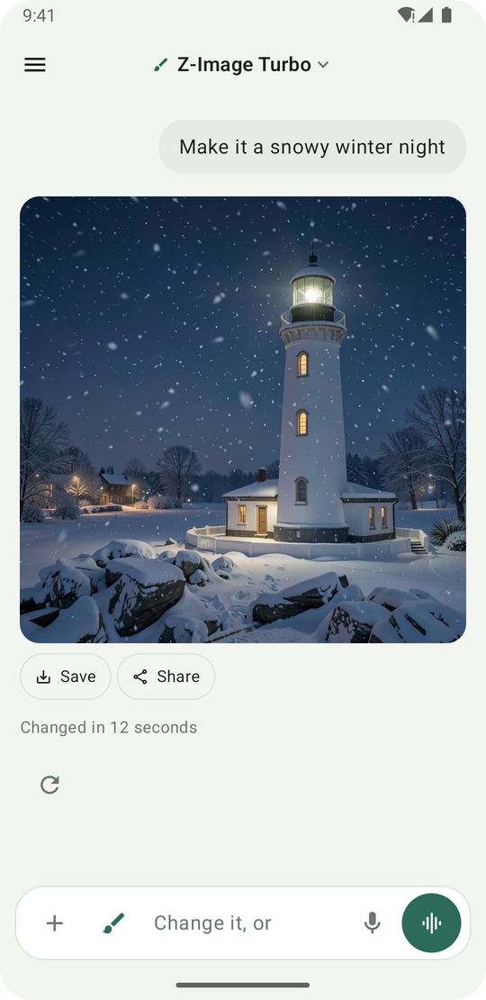
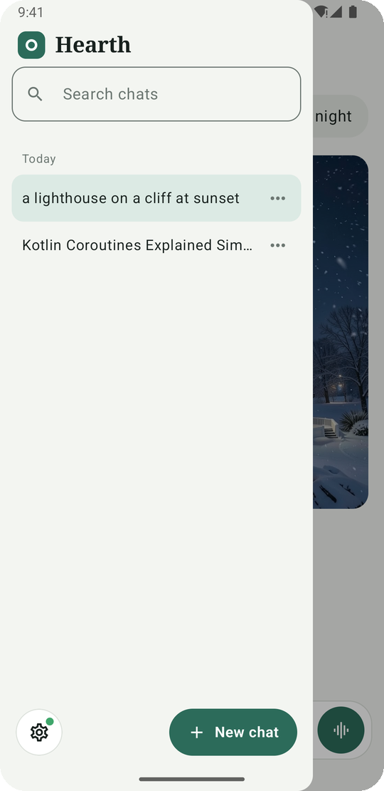

# Hearth for Android

A native Android chat app for your own [Ollama](https://ollama.com) server. Pick any model the server
offers, chat with streamed replies, search the web through your own SearXNG, and talk hands-free with
replies spoken by your own Kokoro voice, and have pictures made by your own ComfyUI. Nothing goes through anyone else's cloud, and your
conversations stay on the device.

<p align="center">
  
  
  
  
</p>

This is the Android sibling of [Hearth for iPhone and iPad](https://github.com/cliftonia/Hearth). The
two share a design and a feature list, not code.

- **Platform**: Android 9+, Kotlin, Jetpack Compose
- **Talks to**: Ollama for chat, [SearXNG](https://github.com/searxng/searxng) for web search and
  [Kokoro-FastAPI](https://github.com/remsky/Kokoro-FastAPI) for speech and
  [ComfyUI](https://github.com/comfyanonymous/ComfyUI) for pictures; all but the first are optional

## What it does

- **Chat** with any model on the server: streamed Markdown, tables, code blocks, maths shown as readable
  text, folded thinking with a level of Off, Light, Medium or High
- **The canvas**: a web page, a drawing, a document or a long block of code in a reply is folded into a card, and the
  card opens it on its own: a page or a drawing shown working, a document laid out, the code with its lines numbered,
  with Copy, Share and a way to step back through earlier versions when you ask for changes
- **Web search when it is needed**: a model that can call tools searches on its own, reads the top pages
  it finds and cites its sources; for other models a toggle searches before the reply
- **Deep research**: choose it as the effort in the model sheet, after Light, Medium and High, and ask a question.
  Hearth has the chat's own model plan a handful of searches, runs them on your SearXNG, reads a dozen of the pages
  found, takes notes on each, looks once more for anything important that is missing, and writes a report that cites
  its sources as `[1]`, `[2]`, with the numbered sources listed beneath it. The steps show while it works, Stop ends
  it at once, and Try again researches again. The choice stays with its chat and is never saved, so a new chat is
  never researched by accident
- **Memory**: lasting facts you tell a model are kept on the device and carried into every conversation;
  a **private chat** uses none and adds none
- **Voice**: dictation by the microphone button or by holding the composer down, replies read aloud as they are
  written, and a hands-free voice conversation
- **Voice with the camera**: turn the camera on in a voice conversation and one still picture goes with each thing
  you say, so that you can ask about what is in front of you. Nothing is recorded
- **Attachments**: photos for models that can see, PDFs and text files for any model
- **Pictures**: make one from a description, change or enlarge a photo, and carry on from the last picture
  with words such as "make it a snowy night"; save or share what is made
- **Share to Hearth** from other apps: words, links, pictures, PDFs and text files land in the composer
- **Edit and resend**, **Try again** with the earlier replies kept to step back through, suggested follow-up
  questions
- **Profile**: your name and what you like to be called, a photo, and standing instructions for every conversation.
  A new chat greets you by name, a little differently each time, and the model is told who it is talking to
- **Notifications**: told on the phone itself when a reply or a picture finishes while Hearth is not on screen;
  a private chat's notification says only that a reply is ready
- **Haptics**: a light tap when a message is sent, a reply finishes or something is switched, with one switch
  that silences them all
- **Projects**: gather chats round a subject, with instructions and reference files (PDFs and text files)
  that every chat in the project is given
- **History**: pin, rename, share as Markdown, delete, search
- **Lock** with fingerprint, face or PIN; light and dark themes; a side-by-side layout on wide screens
- **Erase all data on this device**: there are no accounts, so one button removes everything the app holds
- **Home screen widgets** for a new chat and for a voice conversation

## Finding your way round

- **The composer** is a single row at rest. Tap it and it opens out, showing the options for the reply you are
  about to ask for: the model, web search, and whether replies are read aloud. Which of these appear depends on
  the model and on the servers you have set. Tap the model's name to choose another, and the effort that goes into
  a reply: how hard the model should think, or **Deep research**. While research is chosen the model's name is
  followed by "Deep research" in green and the field reads "Ask a question to research". Without a search address
  it is listed but cannot be chosen.
- **Hold the composer** while it is at rest and empty to talk to it: it listens for as long as you hold, shows how
  loud it hears you, and when you let go your words are in the message field for you to read, change and send.
  Nothing is sent by itself. Sliding your finger off, or leaving the app, stops it too.
- **The top of a chat** holds the private chat button until the first message is sent. From then on it holds a
  new chat button and a menu to pin, share, rename or delete the chat, or to add it to a project. A chat in a
  project shows the project's name beneath.
- **The chat list** slides in from the left. Its **Settings** and **New chat** buttons float at the bottom; the
  dot on Settings is green while your server can be reached. Hold a chat, or tap its dots, to pin, rename,
  share or delete it, or to add it to a project.
- **Projects** are listed at the top of the chat list, above **New project**. Tap one to see only its chats;
  **New chat** then starts a chat in that project, the button beside its name opens its settings, and **All chats**
  leads back. Deleting a project keeps its chats.
- **A voice conversation** has three buttons: the camera, mute and end. The camera button shows what the camera
  sees on a card above the ember, with a button on the card to change between the cameras where the phone has one
  on each side. While it is on, each thing you say is sent with one picture taken as you finish speaking, and that
  picture is kept on your message in the chat like any attached photo. The phone asks for leave to use the camera
  the first time the button is turned on; if it is refused, a notice leads to the phone's Settings and the
  conversation carries on without it. The camera goes off by its button, when the conversation ends and when you
  leave the app, and is off each time a conversation opens. For a model that cannot see pictures the button is
  shown faint with a line saying why; the model is never changed for you.
- **The canvas** opens from the card a reply shows in place of a page, a drawing, a document or a block of code of
  fifteen lines or more; shorter code stays in the reply as before. While the reply is still being written the card
  says so and counts the lines. In the canvas, **Preview** and **Code** switch between the thing itself and its
  text (code has only its text), the arrows step between versions ("2 of 3") when a later reply wrote it again, and
  the canvas follows the newest version as it is written unless you have stepped back. On a wide screen it sits
  beside the chat, and the chat list gives way while there is not room for all three; on a phone it is a page over
  the chat. Its close button, the back button, a new chat and another chat all put it away. Nothing about it is
  saved: it is read out of the reply each time.
- **Private chat** is the padlock at the top right of a chat that has not yet begun. Once the chat has begun,
  the padlock only shows that it is private.
- **Settings** begin with your **Profile**, a page of its own: your photo, names and instructions, whether
  follow-up questions are suggested, and **Erase all data on this device**. Below it come the server addresses,
  web search, **Test connection**, the voice and its **Hear this voice** button, pictures, your memories,
  **Notifications** (a page with a switch for replies), the lock, haptics and the theme. Changes are kept as you
  make them.
- **Notifications** ask the phone for leave only when you turn the **Replies** switch on. If the phone refuses,
  the switch stays on and the page shows where leave is given. Tapping a notification opens its chat.

## How it is built

Three Gradle modules, each seeing only the one below it:

| Module | Holds | Depends on |
|---|---|---|
| `app` | Coordinator, presenters, Compose screens, the design system, the phone's own services (speech, the camera, files, biometrics, notifications) | `domain` |
| `domain` | Models, the chat, research, speech, picture, project and erase interactors, stores, the prompt, research and text transformers, the greeting and notification planners | `data` |
| `data` | HTTP services and DTOs for Ollama, SearXNG, Kokoro and web pages | nothing |

Presenters own their state as a `StateFlow` and tell the coordinator what the user asked for through a
delegate. Dependencies are passed as closures and small provider classes; there is no injection framework.
Inside `app` each screen has a package of its own, holding its presenter beside its composables.

- [docs/ARCHITECTURE.md](docs/ARCHITECTURE.md): the modules, the presenter and coordinator pattern, where
  things live and how to add a screen
- [docs/DESIGN_SYSTEM.md](docs/DESIGN_SYSTEM.md): the colour, type, spacing and shape tokens, the shared
  components, and the rule that screens use nothing else

### What is guarded

- **Web pages are untrusted.** Only public HTTPS pages are fetched; names that resolve to private,
  local or tailnet addresses are refused, and the connection is made to the addresses that were checked.
- **Search results cannot give orders.** They reach the model inside a fence whose marker is made up
  afresh for every search, marked as material to weigh, not instructions.
- **A web page cannot plant a memory.** Memory closes for the whole conversation once it holds a web
  source, a file or a photo, and a model cannot change memories the user wrote.
- **Nor can a project's file.** Reference files reach the model inside a fence of the same kind, marked as
  material and not instructions, and a project that has any closes memory for its chats.
- **Research is under the same rules, and bounded.** The pages a report is written from are fetched through the
  same guarded path as a search's pages, and their text and the notes taken from it reach the model inside a fence
  made up for the run. At most 5 planned searches and 3 more to fill a gap, 12 pages and then 4 more, no more than
  2 pages from one site, 4 pages fetched at once, 12 seconds for a page, 6,000 characters read from each and 24,000
  characters of notes handed to the writer. That is about 15 to 20 requests to the model, all to the one the chat
  already uses. Pages are read by the phone, so those sites see the phone's address. If no page can be read, or
  none says anything about the question, it says so and writes no report. The log holds counts only.
- **A page a model wrote is shut in.** The canvas shows it in a web view that is given the page as text, with no
  address of its own, so it has no files, cookies or storage. Its scripts run, since a page is made of them, but
  every load from the network is refused (requests, pictures, scripts, styles, frames, `fetch`, sockets, beacons),
  every navigation is cancelled, so a link in it opens nothing, here or in the browser, and it is given no window,
  camera, microphone, place, file or download. Peer connections (WebRTC) are taken away from the page and from
  every frame it makes, the moment the frame is made, so it cannot send anything that way either; a packet capture
  on the emulator shows none leaving. **Two things are not yet shut off**, because the phone's web view offers no
  way to do it: a page can still have a name looked up (`dns-prefetch`) and can open a bare connection that
  carries no request (`preconnect`). Neither lets it load anything, but each can carry a little out. See "The
  canvas" in [docs/ARCHITECTURE.md](docs/ARCHITECTURE.md).
- **Only web links open.** Links from a model or a search result with any other scheme lead nowhere.
- **A name stays a name.** The name in your profile reaches the model on one line, in quotation marks it cannot
  close, so it cannot pass itself off as instructions.
- **The camera takes one picture at a time.** Nothing but the live picture on screen is fed while it is on; a
  still is taken only as a spoken turn ends, with no sound, and no video is ever recorded or sent. Turning it off
  closes the camera itself. A picture closes memory for the conversation, as any photo does.
- **A private chat stays private on the lock screen.** Its notification carries neither its title nor a word of
  the reply.

## Building

```sh
cp local.example.properties local.properties   # then fill in your SDK path and server addresses
./gradlew test assembleDebug
```

`local.properties` is ignored by git; your server addresses never enter the repository. The app also
runs with no addresses built in and asks for them in Settings.

## Status

The data and domain modules are covered by unit tests, as are the grouping of the chat list, holding the composer
to talk, what the chat announces when a reply finishes, what the settings do when everything is erased, and deep
research: how it is chosen, run, stopped, kept and asked for again, and the camera of a voice conversation: when
it runs, when it stops and what goes with a spoken turn, and the canvas: what counts as a piece, its versions, what
its page may load, and how a wide screen is shared. The
other presenters and the screens are not yet, and there is no lint or CI configuration. Differences from the
iPhone app: dictation stops when you pause (Android's recogniser takes one utterance at a time), so a held
composer stops listening at the first pause as well; and there is no background keep-alive, so a reply
continues, and its notification is posted, only while Android leaves the app running; that holds for research too, which
takes longer than a reply. A photo sent to a model, from the camera of a voice conversation as from anywhere else,
is at most 1568 pixels on its longest side, where the iPhone app sends 1280. The canvas's page is shut in by the
means Android has, which differ from the iPhone's and leave the two gaps listed under "What is guarded"; and
turning the phone round starts a page in the canvas afresh.
